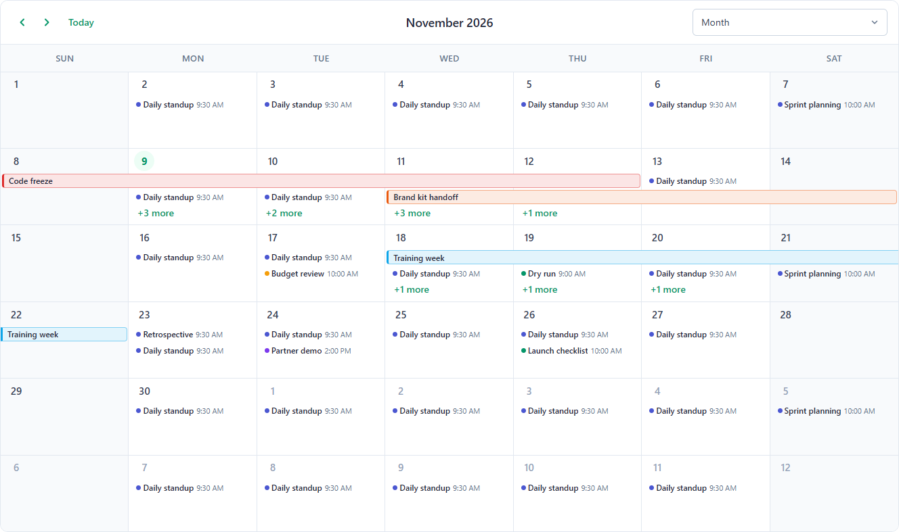
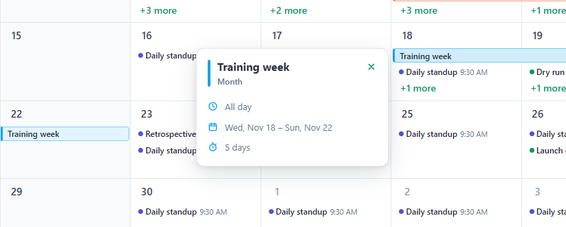
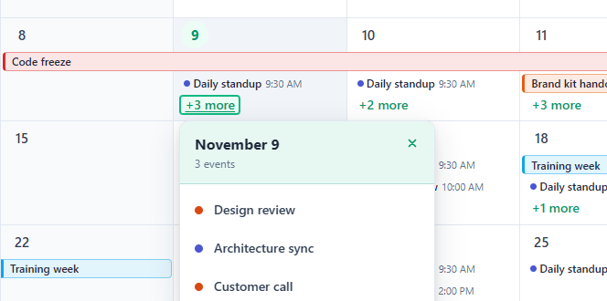
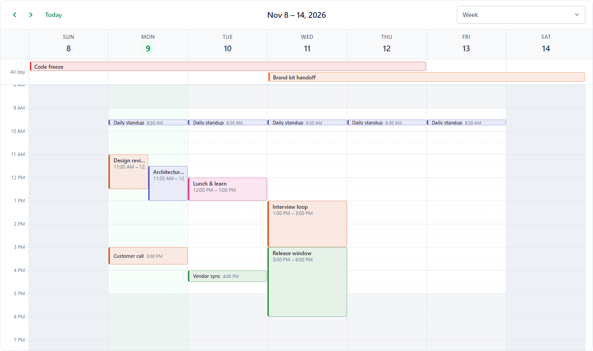
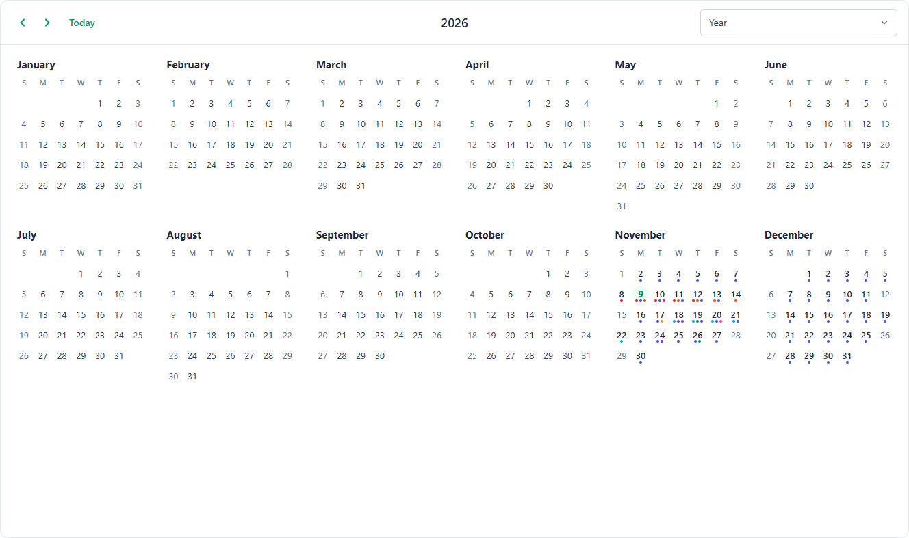
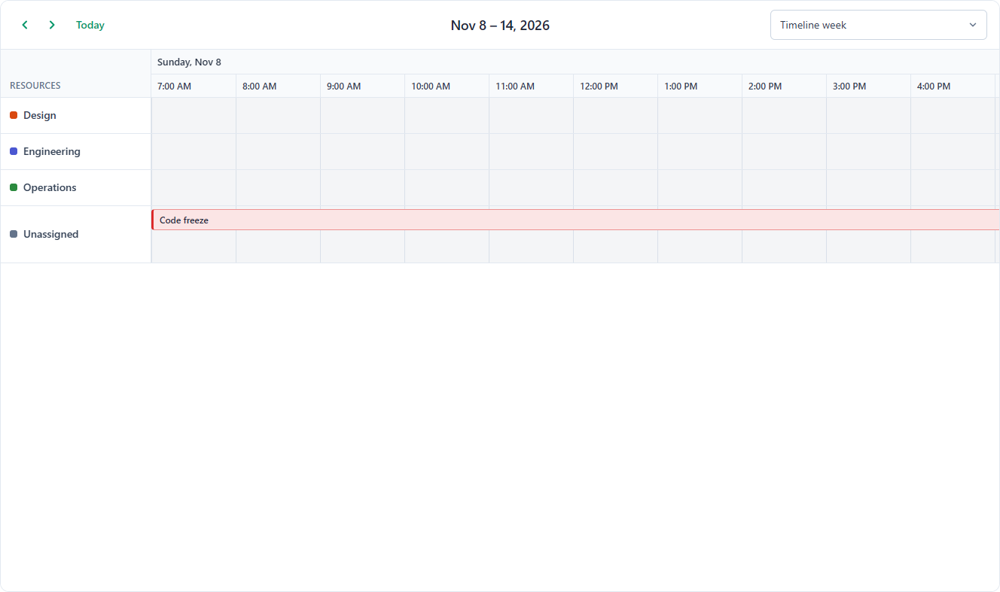
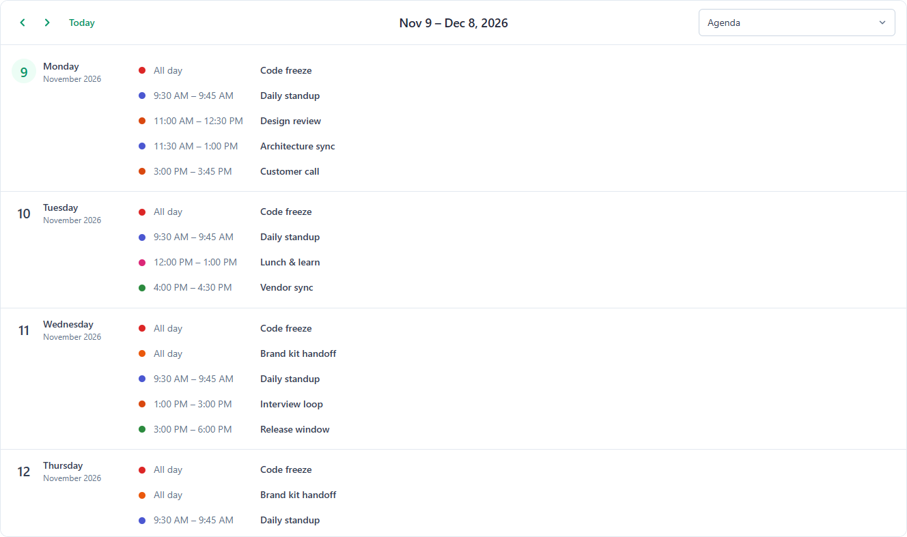
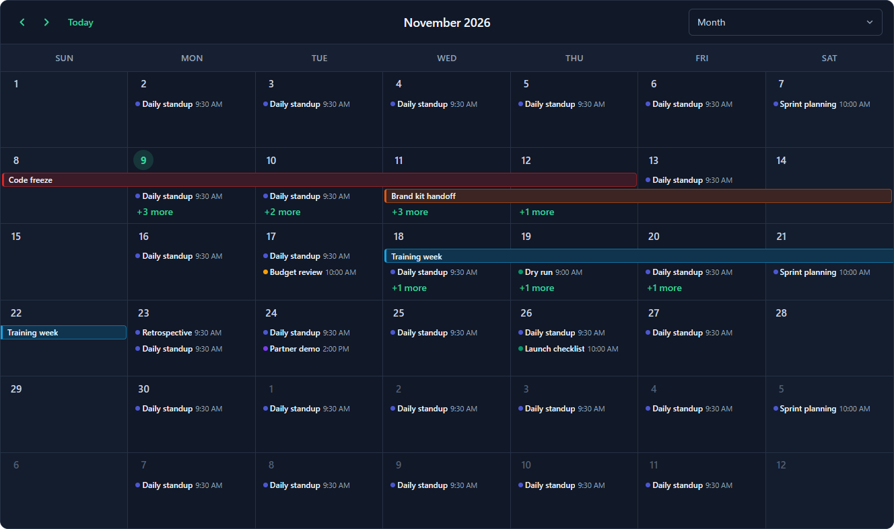

# ngx-calendar-kit

An event scheduler (calendar) for **Angular 22+**, built with signals and styled with SCSS. It has month, week, day, year and agenda views, plus timelines at day, week, month and year scale. Every view shares the same event model, popovers, selection, and drag & resize behavior.

📖 <strong>Documentation:</strong>
<a href="https://builds.siva-geddada.in/projects/ng-fullcalender/docs/" target="_blank" rel="noopener noreferrer">
  Open Documentation
</a>



| Event details | "+N more" list |
| --- | --- |
|  |  |

---

## Contents

1. [Features](#features)
2. [Installation](#installation)
3. [Quick start](#quick-start)
4. [Height & layout](#height--layout)
5. [Events, resources and recurrence](#events-resources-and-recurrence)
6. [Views](#views)
7. [Handling user actions](#handling-user-actions)
8. [Popovers](#popovers)
9. [API reference](#api-reference)
10. [Customizing the layout and templates](#customizing-the-layout-and-templates)
11. [Theming](#theming)
12. [Localization](#localization)
13. [NgModule apps](#ngmodule-apps)
14. [Accessibility](#accessibility)
15. [Not supported yet](#not-supported-yet)
16. [Working on this repository](#working-on-this-repository)
17. [License](#license)

---

## Features

**Month** (dense calendar planning)
- All-day bars that span days and show when they continue from or into another week
- Short summaries of timed events, with a dot, title and time
- Per-day overflow: as many event rows as fit the cell (capped by `maxEventsVisible`), then a "+N more" link that opens a popover
- Range selection, an optional week-number column, and custom day cells

**Week & Day** (timed schedules)
- Business-hours shading, a working-days filter (`daysOfWeek`) and a custom day count (`numberOfDays`)
- An all-day row above the time grid
- Overlapping events placed side by side
- A current-time line, drag & resize snapped to `snapDuration`, and horizontal scrolling on small screens

**Timeline** (horizontal time)
- Four scales: `timelineDay`, `timelineWeek`, `timelineMonth` and `timelineYear`
- Two-level sticky headers and fixed-width slots (`timelineSlotWidth`) with horizontal scrolling
- One row per resource; drag events between rows
- Business-hours and weekend shading, plus the current-time line

**Agenda & Year** (scanning the schedule)
- The agenda groups events by date, with a custom date-header template and optional empty days
- The year view shows twelve mini-months with event dots and today, selected, range and disabled states

**Everywhere**
- Recurring events, with exceptions created automatically when you drag one occurrence
- Event popovers on hover, focus or click
- Light, dark and automatic themes from CSS variables
- `Intl`-based localization, 12h/24h time, keyboard navigation and ARIA labels
- No runtime dependencies besides Angular

## Installation

### From npm (after the package is published)

```bash
npm install ngx-calendar-kit
```

### From this Git repository

The library lives inside this Angular workspace, so build it first, then install the built package into your app:

```bash
git clone https://github.com/siva-geddada/ng-fullCalender.git
cd ng-fullCalender
npm ci
npx ng build ngx-calendar-kit                 # → dist/ngx-calendar-kit

cd /path/to/your-angular-app
npm install /path/to/ng-fullCalender/dist/ngx-calendar-kit
# or: cd dist/ngx-calendar-kit && npm pack, then npm install the generated .tgz
```

## Quick start

```ts
// app.config.ts
import { ApplicationConfig } from '@angular/core';
import { provideSchedulerViews } from 'ngx-calendar-kit/views/all';

export const appConfig: ApplicationConfig = {
  providers: [provideSchedulerViews()], // month, week, day, year, agenda, timeline*
};
```

```ts
// calendar.component.ts
import { Component, signal } from '@angular/core';
import { CALENDAR_IMPORTS, SchedulerEvent } from 'ngx-calendar-kit';

@Component({
  selector: 'app-calendar',
  imports: [CALENDAR_IMPORTS],
  template: `
    <ngx-calendar
      height="parent"
      [events]="events()"
      [(view)]="view"
      [(date)]="date"
      [editable]="true"
      [eventPopover]="true"
    />
  `,
  styles: `:host { display: block; height: 100vh; }`,
})
export class CalendarComponent {
  view = signal('month');
  date = signal(new Date());
  events = signal<SchedulerEvent[]>([
    { id: 1, title: 'Design review', start: '2026-11-09T11:00:00', end: '2026-11-09T12:30:00', color: '#ea580c' },
    { id: 2, title: 'Team offsite', start: '2026-11-12', end: '2026-11-14', allDay: true },
    { id: 3, title: 'Standup', start: '2026-11-02T09:30:00', duration: 15, rrule: 'FREQ=WEEKLY;BYDAY=MO,TU,WE,TH,FR' },
  ]);
}
```

`CALENDAR_IMPORTS` contains the root component, the toolbar, the body and the template directives. A `<ngx-calendar>` with no children renders the toolbar and body itself.

## Height & layout

| Setting | Result |
| --- | --- |
| *(nothing)* | Height comes from width ÷ `aspectRatio` (default `1.2`) |
| `height="parent"` | Fills its parent (`100%`). Give the parent a height, or make the scheduler a flex child with `flex: 1; min-height: 0` |
| `[height]="720"` | Fixed height in pixels |
| `height="calc(100vh - 4rem)"` | Any CSS length |
| `height="auto"` or `[autoHeight]="true"` | Grows with its content. Views don't scroll internally; month cells show `maxEventsVisible` rows |
| `[autoHeight]="{ minHeight: 400, maxHeight: 900 }"` | Auto height with limits |

Month rows always stretch to fill the height. The number of event rows per cell is whatever fits the measured row height, capped by `maxEventsVisible`. The rest of the day's events go into "+N more".

A full-page calendar:

```scss
.page {
  display: flex;
  flex-direction: column;
  height: 100dvh;
}

.page ngx-calendar {
  flex: 1 1 auto;
  min-height: 0;
}
```

```html
<div class="page">
  <app-header />
  <ngx-calendar height="parent" [events]="events()" />
</div>
```

## Events, resources and recurrence

### `SchedulerEvent`

| Field | Type | Notes |
| --- | --- | --- |
| `id` | `string \| number` | Required |
| `title` | `string` | |
| `start` | `string \| Date` | `Date`, ISO string, or `YYYY-MM-DD` (read as local midnight) |
| `end` | `string \| Date` | Exclusive. If missing: `start + duration`, else 1 day (all-day) or 1 hour |
| `allDay` | `boolean` | |
| `duration` | `number` | Minutes; used when `end` is missing |
| `color`, `textColor`, `borderColor` | `string` | Any CSS color. `color` falls back to the resource color, then the accent |
| `className` | `string` | Added to the event element |
| `editable`, `draggable`, `resizable` | `boolean` | Override `editable`, `eventStartEditable` and `eventDurationEditable` for this event |
| `resourceId` / `resourceIds` | `string \| number` / `(string \| number)[]` | Timeline rows; an event with several resources appears in each row |
| `rrule` | `string \| RRuleOptions` | `'FREQ=WEEKLY;BYDAY=MO,WE;COUNT=10'` or `{ freq: 'WEEKLY', byDay: ['MO','WE'], count: 10 }` |
| `exdate` / `rdate` | `Date[] \| string` | Occurrence starts to skip or add (a string is comma-separated) |
| `recurrenceId` | `string \| Date` | Set on exceptions (the original occurrence start) |
| `categoryId(s)`, `timezone`, `metadata` | | Passed through untouched |

### `SchedulerResource`

```ts
{ id: 'eng', title: 'Engineering', color: '#4b57d1' }
```

### Recurrence

| Part | Values |
| --- | --- |
| `FREQ` | `DAILY`, `WEEKLY`, `MONTHLY`, `YEARLY` |
| `INTERVAL` | every *n* periods |
| `COUNT` | total occurrences, counted from `start` |
| `UNTIL` | `YYYYMMDD`, `YYYYMMDDTHHmmss`, or `…Z` (UTC) |
| `BYDAY` | `SU,MO,TU,WE,TH,FR,SA` (weekly rules) |

Payloads describe an occurrence of a series as an `ExpandedEvent` (`id`, `originalId`, `isRecurring`, `originalStart`, …). A non-recurring event is passed as your original object.

## Views

| `view` | Shows | Provider (import path) |
| --- | --- | --- |
| `month` | 6-week grid | `provideSchedulerMonthView()` (`ngx-calendar-kit/views/month`) |
| `week` | Time grid, aligned week or `numberOfDays` | `provideSchedulerWeekView()` (`…/views/week`) |
| `day` | Time grid for one day | `provideSchedulerDayView()` (`…/views/day`) |
| `year` | Twelve mini-months | `provideSchedulerYearView()` (`…/views/year`) |
| `agenda` | `agendaDays` days as a list | `provideSchedulerAgendaView()` (`…/views/agenda`) |
| `timelineDay` / `timelineWeek` | Hour slots (`timelineSlotDuration`) | `provideSchedulerTimelineViews()` (`…/views/timeline`) |
| `timelineMonth` / `timelineYear` | Day slots / month slots | same |
| `resourceTimelineDay` / `Week` / `Month` | The timeline views under the resource view names | same |
| everything | | `provideSchedulerViews()` (`…/views/all`) |

The `views` input picks which registered views are available, in which order. It defaults to `['month','week','day','year','agenda']`. The toolbar's view dropdown comes from `headerToolbar`.

| | |
| --- | --- |
|  |  |
|  |  |

## Handling user actions

The scheduler keeps a **working copy** of `events`. Drags, resizes and the `addEvent`/`updateEvent`/`removeEvent` methods change that copy, and the scheduler reports each change. Any new value you pass to `[events]` replaces the working copy.

```html
<ngx-calendar
  #scheduler
  [events]="events()"
  [editable]="true"
  (dateClick)="onDateClick($event)"
  (dateSelect)="onSelect($event)"
  (eventClick)="open($event.event)"
  (eventDrop)="onDrop($event)"
  (eventResizeStop)="onResize($event)"
  (eventChange)="events.set(scheduler.getEvents())"
/>
```

```ts
onSelect(s: SchedulerDateSelectPayload) {
  // s.start, s.end, s.allDay, s.startStr / s.endStr (ISO), s.resource (timeline row), s.view
  this.scheduler().addEvent({ id: crypto.randomUUID(), title: 'New event', start: s.start, end: s.end, allDay: s.allDay });
  this.scheduler().unselect();
}

async onDrop(d: EventDropPayload) {
  // d.event (new), d.oldEvent, d.newStart, d.newEnd, d.newResource, d.delta { days, milliseconds }
  try {
    await this.api.save(d.event);
  } catch {
    d.revert(); // put it back
  }
}
```

**Recurring events:** dragging or resizing one occurrence adds its start to the series' `exdate` and creates a standalone event (with `recurrenceId`) in its place.

**Rules:**
- `editable` (off by default) turns on drag and resize. `eventStartEditable` and `eventDurationEditable` control them separately, and an event's own `editable`, `draggable` and `resizable` override all three.
- `readonly` blocks edits and selection but keeps navigation and clicks. `disabled` blocks every interaction inside the view.
- `eventAllow(dropInfo, event)` and `selectAllow(selectInfo)` can reject a drop or a selection. A rejected target shows a dashed red outline.
- `minDate` and `maxDate` disable dates, limit navigation, and reject drops and selections outside the range.

## Popovers

| Action | Result |
| --- | --- |
| Hover an event (`[eventPopover]="true"`) | After `eventPopoverDelay` ms, a preview card shows time, date, duration, resource and whether it repeats |
| Tab to an event | The same card, linked to the event with `aria-describedby` |
| Click an event or press Enter on it | Fires `eventClick` and pins the card, with a close button |
| Click "+N more" (`showMorePopover`) | Opens a list of the day's hidden events; clicking the link again closes it |
| Escape, a click outside, scrolling, or navigating | Closes the popover |

`eventPopoverPosition` (`'right'` by default, or `'left'`, `'top'`, `'bottom'`) sets the preferred side. If the card doesn't fit there, it flips to the opposite side.

## API reference

### Inputs

| Input | Type | Default |
| --- | --- | --- |
| **Data** | | |
| `events` | `SchedulerEvent[]` | `[]` |
| `resources` | `SchedulerResource[]` | `[]` |
| `view` (two-way) | `SchedulerViewType` | `'month'` |
| `date` (two-way) | `Date` | today |
| `views` | `SchedulerViewType[]` | `['month','week','day','year','agenda']` |
| **Layout** | | |
| `height` | `number \| 'auto' \| 'parent' \| string` | — |
| `aspectRatio` | `number` (width ÷ height) | `1.2` |
| `autoHeight` | `boolean \| AutoHeightOptions` | `false` |
| `headerToolbar` | `false \| { left, center, right }` | `{ left: 'prev,next today', center: 'title', right: 'month,week,day' }` |
| `theme` | `'light' \| 'dark' \| 'auto'` | `'light'` |
| `ariaLabel` | `string` | `'Scheduler'` |
| **Time & locale** | | |
| `locale` | `string` | browser |
| `timeFormat` | `{ format: '12h' \| '24h' \| 'auto' }` | `auto` |
| `firstDayOfWeek` | `0`–`6` | `0` |
| `slotDuration` | minutes (`5,10,15,20,30,60`) | `30` |
| `slotMinTime` / `slotMaxTime` | `'HH:mm'` | `'00:00'` / `'24:00'` |
| `snapDuration` | minutes | `slotDuration` |
| `scrollTime` | `'HH:mm'` | `'08:00'` |
| `daysOfWeek` | `number[]` | all |
| `numberOfDays` | `number` | — |
| `businessHours` | `boolean \| BusinessHoursConfig \| BusinessHoursConfig[]` | `false` (`true` = Mon–Fri 09:00–17:00) |
| `showBusinessHours` | `boolean` | `true` |
| `weekNumbers` / `weekNumbering` | `boolean` / `'auto' \| 'iso' \| 'us'` | `false` / `'iso'` |
| `nowIndicator` / `nowIndicatorInterval` | `boolean` / ms | `true` / `60000` |
| `minDate` / `maxDate` | `Date \| string \| null` | — |
| `navLinks` | `boolean` (day numbers open the day view) | `false` |
| **Interaction** | | |
| `editable` | `boolean` | `false` |
| `eventStartEditable` / `eventDurationEditable` | `boolean` | `true` / `true` |
| `selectable` | `boolean` | `true` |
| `readonly` / `disabled` | `boolean` | `false` / `false` |
| `dragMinDistance` | px | `5` |
| `eventAllow` / `selectAllow` | callbacks | — |
| **Month / agenda** | | |
| `maxEventsVisible` | `number` | `5` |
| `showMorePopover` | `boolean` | `true` |
| `agendaDays` | `number` | `30` |
| `showEmptyDays` | `boolean` | `false` |
| `noEventsMessage` | `string` | — |
| **Popovers** | | |
| `eventPopover` | `boolean` | `false` |
| `eventPopoverDelay` / `eventPopoverHideDelay` | ms | `300` / `100` |
| `eventPopoverPosition` | `'top' \| 'bottom' \| 'left' \| 'right'` | `'right'` |
| **Timeline** | | |
| `timelineSlotDuration` | minutes | `60` |
| `timelineSnapDuration` | minutes | `timelineSlotDuration` |
| `timelineSlotWidth` | px | `112` |
| `timelineMinTime` / `timelineMaxTime` | `'HH:mm'` | `slotMinTime` / `slotMaxTime` |
| `resourceAreaWidth` | px | `200` |
| `resourceRowHeight` | px | `48` |
| `resourceAreaHeaderContent` | `string` | `'Resources'` |
| **Text** | | |
| `text` | `Partial<SchedulerText>` | English |

### Outputs

| Output | Payload |
| --- | --- |
| `dateClick` | `{ date, dateStr, allDay, jsEvent, resource?, view }` |
| `dateSelect` | `{ start, end, startStr, endStr, allDay, jsEvent, resource?, view }` |
| `dateUnselect` | `{ view }` |
| `eventClick` / `eventDblclick` | `{ el, event, jsEvent, view }` |
| `eventMouseenter` / `eventMouseleave` | `{ el, event, jsEvent, view }` |
| `eventDragStart` / `eventDragStop` | `{ event, el?, jsEvent, view }` |
| `eventDrag` | `{ event, delta, jsEvent, view }` (while dragging) |
| `eventDrop` | `{ event, oldEvent, newStart, newEnd, newResource?, delta, revert, view }` |
| `eventResizeStart` | `{ event, el, jsEvent, view }` |
| `eventResize` | `{ event, startDelta, endDelta, jsEvent, view }` (while resizing) |
| `eventResizeStop` | `{ event, oldEvent, startDelta, endDelta, revert, view }` |
| `eventResourceChange` | `{ event, oldResource?, newResource?, view }` |
| `eventChange` | `{ event, oldEvent }` (after any drop, resize or `updateEvent`) |
| `eventAdd` / `eventRemove` | `event` / `{ event }` |
| `moreClick` | `{ date, events, jsEvent, resource?, sourceView, view }` |
| `datesChange` | `{ start, end }` (visible range) |
| `viewStateChange` | `{ dateRange, view }` |
| `viewChange` / `dateChange` | from the `[(view)]` / `[(date)]` bindings |

### Methods

Reach them with a template reference (`#s="ngxCalendar"`, or `#s` on the element) or `viewChild(NgxCalendar)`:

| Method | |
| --- | --- |
| `addEvent(event)`, `updateEvent(event)`, `removeEvent(id)` | Change the working copy and emit `eventAdd` / `eventChange` / `eventRemove` |
| `getEvents()`, `getEventById(id)` | Read the working copy |
| `getResources()`, `getResourceById(id)` | |
| `changeView(view)`, `getView()` | |
| `gotoDate(date \| 'YYYY-MM-DD')`, `getDate()`, `getDateRange()` | |
| `next()`, `prev()`, `today()` | |
| `select(start, end)`, `unselect()`, `clearSelection()` | |

### Toolbar

`headerToolbar` sections accept `prev`, `next`, `today`, `title` and view names. A comma joins items into one group and a space separates groups. View names are shown as a dropdown. Use `<ngx-calendar-toolbar switcher="buttons" />` for a row of buttons instead. Set `[headerToolbar]="false"` to hide the toolbar.

```ts
headerToolbar = { left: 'prev,next today', center: 'title', right: 'month,week,day,year,agenda,timelineWeek' };
```

## Customizing the layout and templates

```html
<ngx-calendar [events]="events()">
  <!-- Event body (all views) -->
  <ng-template ngxCalendarEvent let-occ let-event="event" let-compact="compact">
    <strong>{{ event.title }}</strong>
  </ng-template>

  <!-- Day headers (week/day columns, month cells) -->
  <ng-template ngxCalendarDayHeader let-date let-today="today">{{ date | date: 'EEE d' }}</ng-template>

  <!-- Agenda date headers -->
  <ng-template ngxCalendarAgendaDateHeader let-date let-events="events">
    {{ date | date: 'fullDate' }} · {{ events.length }}
  </ng-template>
</ngx-calendar>
```

**Your own toolbar or view:** place any component inside `<ngx-calendar>` and call `injectSchedulerContext()` from `ngx-calendar-kit/context`. It exposes `view()`, `date()`, `range()`, `title()`, `occurrences()`, `selection()`, `next()`, `prev()`, `today()` and `setView()`. A custom view is a `SchedulerViewDefinition` (`type`, `labelKey`, `component`, `range`, `step`, `title`, plus optional `period` and `data`) registered with `provideSchedulerView()`.

## Theming

Styles are written in SCSS and compiled into the component, so you don't need a global stylesheet. The tokens are CSS variables with zero specificity, so any rule of yours wins:

```scss
ngx-calendar {
  --ngx-calendar-accent: #2563eb;
  --ngx-calendar-accent-text: #1d4ed8;
  --ngx-calendar-today: #eff6ff;
  --ngx-calendar-hour-height: 4rem;
}
```

```scss
@use 'ngx-calendar-kit/styles' as sch;

.my-calendar {
  @include sch.theme(('accent': #2563eb, 'weekend': #fafafa));
}
```

| Token | Purpose |
| --- | --- |
| `accent`, `accent-text`, `accent-contrast` | Accent color, its text color, and text placed on top of it |
| `bg`, `surface`, `surface-alt`, `surface-hover`, `header-bg` | Backgrounds |
| `weekend`, `today`, `today-cell`, `selection` | Day states |
| `border`, `border-strong` | Lines |
| `text`, `text-strong`, `text-muted`, `outside-text` | Text |
| `event-tint`, `event-border-mix` | How strongly event colors tint backgrounds and borders |
| `radius`, `radius-sm`, `radius-xs` | Corner radius |
| `gutter`, `hour-height`, `week-col-min`, `month-head`, `month-lane`, `year-month-min` | Sizes |
| `shadow`, `popover-shadow`, `drag-shadow`, `font`, `font-size` | |

`theme="dark"` uses the dark palette; `theme="auto"` follows `prefers-color-scheme`.



## Localization

```html
<ngx-calendar
  locale="de-DE"
  [firstDayOfWeek]="1"
  [timeFormat]="{ format: '24h' }"
  [text]="{ today: 'Heute', month: 'Monat', week: 'Woche', day: 'Tag', year: 'Jahr', allDay: 'Ganztägig', more: moreText }"
/>
```

```ts
moreText = (n: number) => `+${n} weitere`;
```

The default English text is exported as `DEFAULT_TEXT`, and its keys are typed by `SchedulerText`.

## NgModule apps

```ts
import { SchedulerKitModule } from 'ngx-calendar-kit/module'; // also registers every view

@NgModule({ imports: [SchedulerKitModule] })
export class CalendarModule {}
```

## Accessibility

- Week/day slots, month cells and year days use roving focus: arrow keys move, Home/End jump within a day, and Enter/Space emits `dateClick` and `dateSelect`.
- Events are focusable and work with Enter/Space. Their details card is linked with `aria-describedby`, and a pinned card is a `dialog`.
- "+N more" reports `aria-expanded`, and its list closes with Escape.
- Every cell has a full date (and time) `aria-label`. Disabled dates report `aria-disabled`.
- The toolbar title is announced on navigation, and the view dropdown has a label.
- Animations are turned off for users who prefer reduced motion.

## Not supported yet

The API reference this follows also has these features, which aren't implemented here:

- Resource *grid* views (`resourceDay`/`Week`/`Month`, `dateDay`/`Week`/`Month`), resource hierarchies, grouping and adaptive mode
- Time zone conversion (`timezone`, `displayTimezone`), non-Gregorian calendars, RTL
- Timeline virtualization, appointment slots, blocked intervals, conflict and capacity detection
- Quick-info edit/delete, inline editing, event selection and bulk actions, context menus
- Categories and legends, import/export (iCal, CSV, JSON, XLSX, PDF), printing
- `density`, `stacking`, `dateDisplay` and other display options

## Working on this repository

```
.
├── projects/ngx-calendar-kit/        # the library
│   ├── src/lib/core/                 # Angular-free logic: dates, normalization, layout, recurrence
│   ├── src/lib/state/                # store, context, text, view registry
│   ├── src/lib/components/           # root, toolbar, body, popover, templates
│   ├── src/lib/views/                # time grid, month, year, agenda, timeline
│   ├── src/styles/                   # SCSS tokens, themes and per-view styles
│   └── views/*, context/, module/    # secondary entry points
├── src/                              # demo app
└── docs/images/                      # screenshots used in this README
```

| Task | Command |
| --- | --- |
| Install | `npm ci` |
| Build the library | `npx ng build ngx-calendar-kit` (add `--watch` while developing) |
| Run the demo | `npx ng serve sample` |
| Tests | `npx ng test ngx-calendar-kit --watch=false` and `npx ng test sample --watch=false` |

A one-off `ng build` wipes `dist/` and breaks a running `ng serve`. Use `--watch`, or restart the dev server after a build.

**Publishing:** run `npx ng build ngx-calendar-kit`, then `cd dist/ngx-calendar-kit`, `npm pack --dry-run`, `npm login` and `npm publish --access public`.

## License

ngx-calendar-kit uses the **MIT License with an attribution requirement** (see [LICENSE](projects/ngx-calendar-kit/LICENSE)). You may use, modify and distribute it freely, including in commercial products, **as long as your app shows a visible credit**:

> Any application, website or other product that uses the library must display the text **"Powered by ng-fullcalender"** with a working link to **https://builds.siva-geddada.in/projects/ng-fullcalender/docs/** somewhere users can reasonably see it, such as an About page, credits screen, help page or footer.

For example:

```html
<footer>
  Powered by <a href="https://builds.siva-geddada.in/projects/ng-fullcalender/docs/" target="_blank" rel="noopener">ng-fullcalender</a>
</footer>
```

To use it without the credit, ask the copyright holder for written permission.

> This is a custom license, not an OSI-approved one. Have a lawyer review it if it matters for your project.
