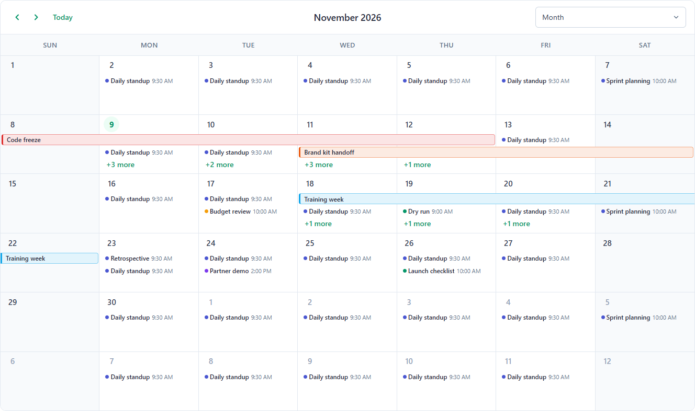
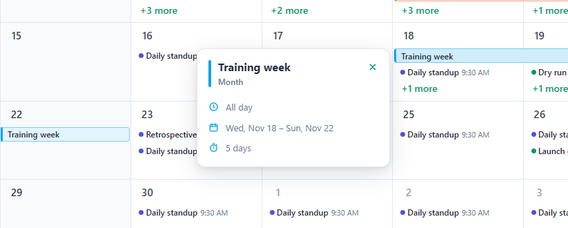
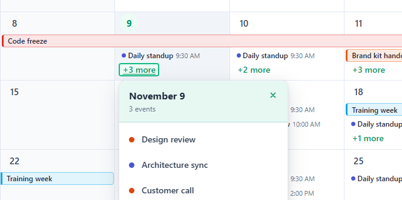

# ngx-calendar-kit

An event scheduler (calendar) for **Angular 22+**, built with signals and styled with SCSS. It has month, week, day, year and agenda views, plus timelines at day, week, month and year scale. Every view shares the same event model, popovers, selection, and drag & resize behavior.

| Event details | "+N more" list |
| --- | --- |
|  |  |

## Features

**Month** (dense calendar planning)
- All-day bars that span days and show when they continue from or into another week
- Short summaries of timed events, with a dot, title and time
- Per-day overflow: as many event rows as fit the cell (capped by `maxEventsVisible`), then a "+N more" link that opens a popover
- Range selection, an optional week-number column, and custom day cells

**Week & Day** (timed schedules)
- Business-hours shading, a working-days filter (`daysOfWeek`) and a custom day count (`numberOfDays`)
- An all-day row above the time grid
- Overlapping events placed side by side
- A current-time line, drag & resize snapped to `snapDuration`, and horizontal scrolling on small screens

**Timeline** (horizontal time)
- Four scales: `timelineDay`, `timelineWeek`, `timelineMonth` and `timelineYear`
- Two-level sticky headers and fixed-width slots (`timelineSlotWidth`) with horizontal scrolling
- One row per resource; drag events between rows
- Business-hours and weekend shading, plus the current-time line

**Agenda & Year** (scanning the schedule)
- The agenda groups events by date, with a custom date-header template and optional empty days
- The year view shows twelve mini-months with event dots and today, selected, range and disabled states

**Everywhere**
- Recurring events, with exceptions created automatically when you drag one occurrence
- Event popovers on hover, focus or click
- Light, dark and automatic themes from CSS variables
- `Intl`-based localization, 12h/24h time, keyboard navigation and ARIA labels
- No runtime dependencies besides Angular

## Next steps

- [Install the package](installation.md)
- [Build your first calendar](quick-start.md)
- [Browse the API reference](api-reference.md)
