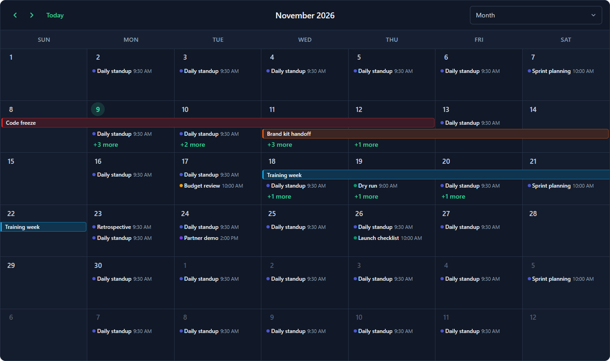

# Theming

Styles are written in SCSS and compiled into the component, so you don't need a global stylesheet. The tokens are CSS variables with zero specificity, so any rule of yours wins:

```scss
sch-scheduler {
  --sch-accent: #2563eb;
  --sch-accent-text: #1d4ed8;
  --sch-today: #eff6ff;
  --sch-hour-height: 4rem;
}
```

```scss
@use 'ng-scheduler-kit/styles' as sch;

.my-calendar {
  @include sch.theme(('accent': #2563eb, 'weekend': #fafafa));
}
```

| Token | Purpose |
| --- | --- |
| `accent`, `accent-text`, `accent-contrast` | Accent color, its text color, and text placed on top of it |
| `bg`, `surface`, `surface-alt`, `surface-hover`, `header-bg` | Backgrounds |
| `weekend`, `today`, `today-cell`, `selection` | Day states |
| `border`, `border-strong` | Lines |
| `text`, `text-strong`, `text-muted`, `outside-text` | Text |
| `event-tint`, `event-border-mix` | How strongly event colors tint backgrounds and borders |
| `radius`, `radius-sm`, `radius-xs` | Corner radius |
| `gutter`, `hour-height`, `week-col-min`, `month-head`, `month-lane`, `year-month-min` | Sizes |
| `shadow`, `popover-shadow`, `drag-shadow`, `font`, `font-size` | |

`theme="dark"` uses the dark palette; `theme="auto"` follows `prefers-color-scheme`.


