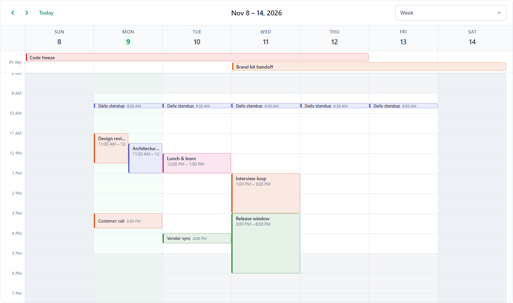
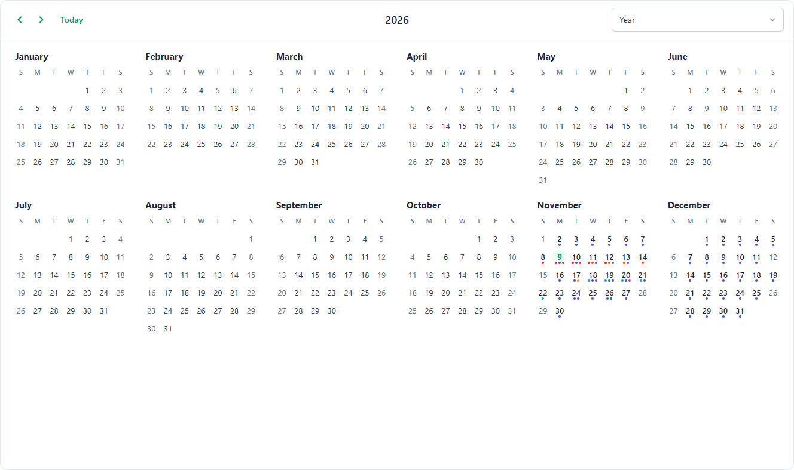
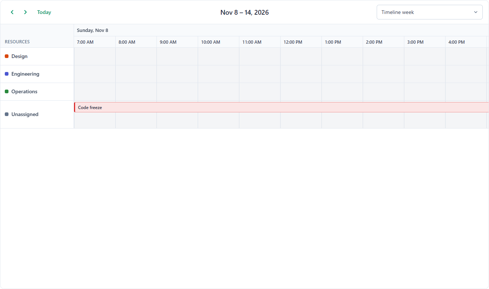
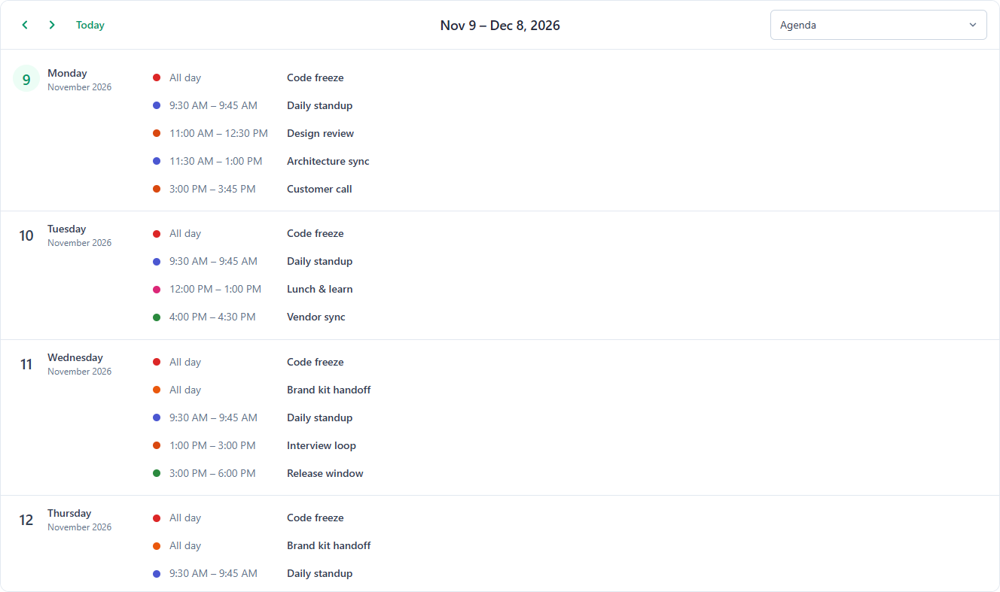

# Views

| `view` | Shows | Provider (import path) |
| --- | --- | --- |
| `month` | 6-week grid | `provideSchedulerMonthView()` (`ng-fullcalender/views/month`) |
| `week` | Time grid, aligned week or `numberOfDays` | `provideSchedulerWeekView()` (`…/views/week`) |
| `day` | Time grid for one day | `provideSchedulerDayView()` (`…/views/day`) |
| `year` | Twelve mini-months | `provideSchedulerYearView()` (`…/views/year`) |
| `agenda` | `agendaDays` days as a list | `provideSchedulerAgendaView()` (`…/views/agenda`) |
| `timelineDay` / `timelineWeek` | Hour slots (`timelineSlotDuration`) | `provideSchedulerTimelineViews()` (`…/views/timeline`) |
| `timelineMonth` / `timelineYear` | Day slots / month slots | same |
| `resourceTimelineDay` / `Week` / `Month` | The timeline views under the resource view names | same |
| everything | | `provideSchedulerViews()` (`…/views/all`) |

The `views` input picks which registered views are available, in which order. It defaults to `['month','week','day','year','agenda']`. The toolbar's view dropdown comes from `headerToolbar`.

| | |
| --- | --- |
|  |  |
|  |  |
